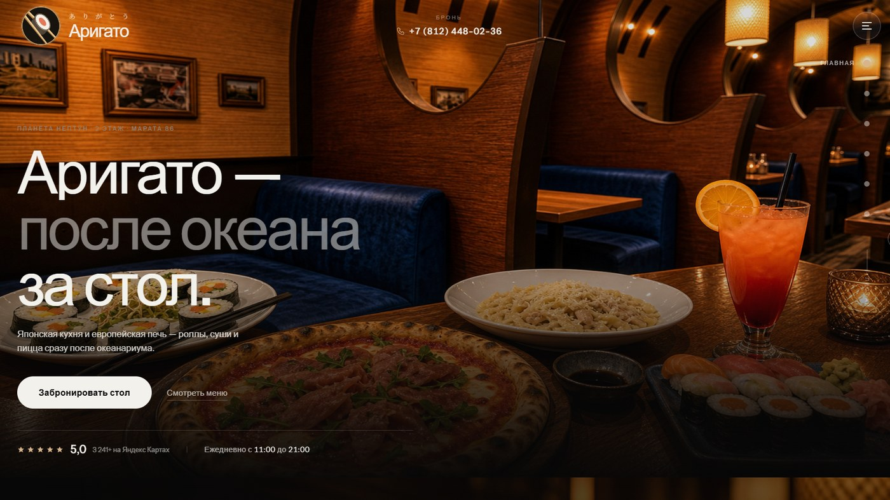

# 🍣 Ресторан «Аригато»

<p align="center">
  
</p>

Японская и итальянская кухня на втором этаже ТРК «Планета Нептун»: свежие роллы, пицца из печи, том ям после океанариума. Зал с круглыми окнами-иллюминаторами, мягкий свет, детское меню. Рейтинг 5,0, больше трёх тысяч оценок. Ежедневно 11:00–21:00.

## 🌊 После океана — за стол

Сайт не продаёт «ещё одни суши у ТЦ». Сценарий другой: вышел из океанариума — сел за стол. Первый экран открывается иллюминатором: круглая маска разъезжается, за ней зал. Дальше история места крутится со скроллом — роллы, пицца, том ям — как главы, а не как блоки «о нас».

Бронь по телефону. Доставка и навынос есть, корзины на сайте нет.

## 🛠️ На чём сделан

Одностраничное приложение на **React** (`js/site.js`) плюс собранные стили. Движение — **GSAP ScrollTrigger** и плавный скролл **Lenis**. Шрифты Instrument Sans и Noto Serif JP. JSON-LD `Restaurant`. `prefers-reduced-motion` выключает прелоадер, курсор и пины. Исходники лежат в корне папки, без обёртки `code/`.

## ✨ Что реализовано

- Герой с «иллюминатором»: круг раскрывает зал, заголовок собирается по строкам.
- Три сцены на полный экран — роллы, пицца, том ям — с прогрессом «листай · история места».
- Меню на вкладках, прибитое к экрану: роллы, сеты, нигири, салаты, десерты, с хитами в карте.
- Горизонтальная лента зала, которая едет вместе со скроллом.
- Отзывы, визит с картой, липкая кнопка записи на телефоне.
- Кастомный курсор с кольцом на десктопе, skip-link, прелоадер с именем места.

## 📁 Структура

```
├── index.html
├── css/
├── js/
│   └── site.js            # собранный React
├── hero/
├── brand/
├── full-website.png
├── readme-preview.jpg
├── pre-video.mp4
└── favicon.png
```

## 🚀 Локальный запуск

```bash
python -m http.server 8080
```

Откройте `http://localhost:8080` в браузере.

---

## 👨‍💻 Разработчик

*   **Лаврешин Илья Александрович**

---

## 📧 Контакты

По всем вопросам и предложениям вы можете написать на почту:  
[](mailto:ilyalav2323@gmail.com)
