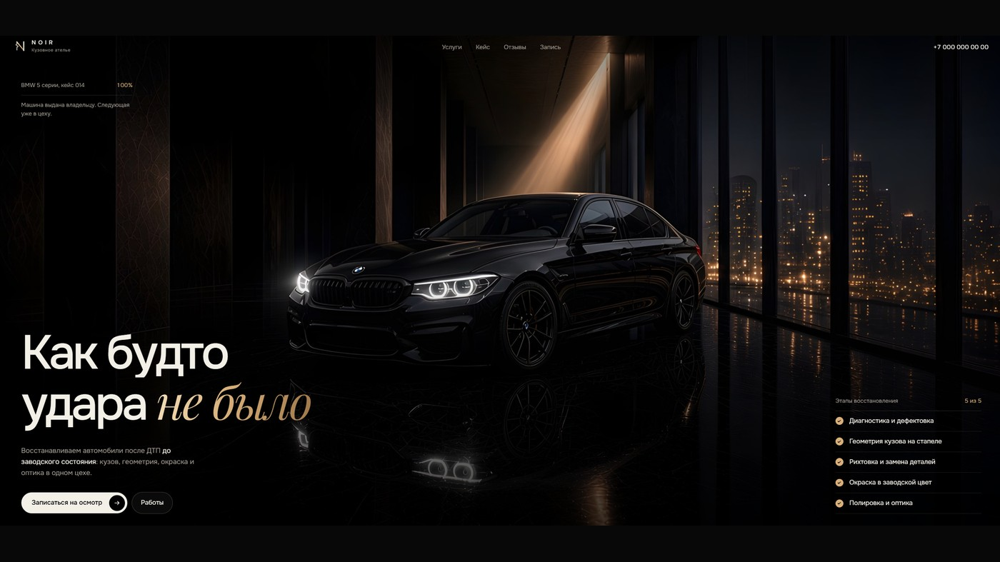

# 🖤 NOIR

<p align="center">
  
</p>

Ателье, которое возвращает машину после удара: кузов, геометрия, окраска, полировка и детейлинг. Один цех, без субподряда. Слоган на первом экране — «как будто удара не было». Петербург.

## 🔧 Сборка на скролле

Сайт не прайс «от» на белом фоне. Битая машина на первом экране собирается по мере прокрутки: дефектовка, стапель, рихтовка, камера, полировка. Процент идёт счётчиком, этапы отмечаются по ходу. В конце машина уезжает из цеха кадр за кадром — 170 кадров, отдельные наборы для широкого экрана и для телефона.

Дальше по странице тот же приём: машина въезжает в бокс на услугах и подъезжает к кейсу.

## 🛠️ На чём сделан

Приложение на **React 19** и **Vite**. Анимация — **GSAP** и ScrollTrigger (`@gsap/react`). Стили — Tailwind v4. Шрифты Playfair Display и Onest. `prefers-reduced-motion` отключает скролл-сцены и появление блоков. Исходники в `src/`, собранная статика — в `dist/`.

## ✨ Что реализовано

- Сцена восстановления: маска «проявляется» по кузову, пять этапов, прогресс `000–100`.
- Фильм выдачи: canvas листает webp-кадры, пока машина уезжает из цеха.
- Услуги на весь экран: машина едет по полу, панели сменяются со скроллом. Срок, цена «от», гарантия.
- Кейсы Audi, BMW, Mercedes и Range Rover: до / после, срок в днях.
- Отзывы со стрелками-спидометрами: 14 лет, 1 860 машин, 98% возвращаются.
- Запись: карта кузова, зоны удара кликаются, телефон маскируется, на выходе — номер талона.
- Шапка крепнет после героя, мобильное меню на весь экран, skip-link.
- В подвале номер на Audi RS 7 ведёт на GitHub.

## 📁 Структура

```
├── index.html
├── package.json
├── src/
│   ├── App.jsx
│   ├── components/
│   └── hooks/
├── public/                # кадры героя, бокса и выдачи
├── dist/
├── promo-Video/
├── full-website.png
└── readme-preview.jpg
```

## 🚀 Локальный запуск

```bash
npm install
npm run dev
```

Vite поднимет страницу на `http://localhost:5173`.

---

## 👨‍💻 Разработчик

*   **Лаврешин Илья Александрович**

---

## 📧 Контакты

По всем вопросам и предложениям вы можете написать на почту:  
[](mailto:ilyalav2323@gmail.com)
