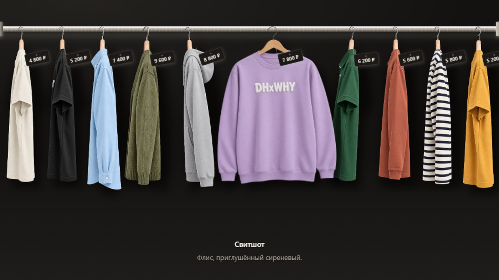

# 🧥 Рейка

<p align="center">
  
</p>

Витрина, а не каталог с карточками. Десять вещей висят на одной металлической штанге: футболки, рубашка, кардиган, худи, свитшот, поло, хенли, лонгслив. У каждой — ценник на вешалке. Фотографии вшиты в страницу, отдельных папок с картинками нет.

## 🪝 Потяни вешалку

Наведение разворачивает вещь лицом. Вешалку можно сдвинуть вдоль штанги — соседи качнутся. Клик открывает крупный вид: описание, «спереди» и «сзади», поворот жестом. Пока никто не трогает рейку, вещи показываются сами по очереди. На узком экране штанга становится каруселью.

## 🛠️ На чём сделан

Один файл **HTML**: разметка, стили и логика вместе. Tailwind собран внутрь страницы. Без Node.js, без сборки и без бэкенда. Клавиатура: стрелки, Home, End, Escape закрывает карточку.

## ✨ Что реализовано

- Рейка из десяти вещей с ценниками и подписью выбранной.
- Разворот лицом при наведении и при выборе.
- Перетаскивание вешалки: соседние вещи качаются следом.
- Крупная карточка: описание, ракурс спереди / сзади, поворот мышью или пальцем.
- Автопросмотр, который останавливается, как только вмешиваются.
- Мобильная карусель вместо длинной штанги.
- Скриншоты состояний лежат в `promo/`.

## 📁 Структура

```
├── index.html             # интерфейс, стили, логика и фото
├── promo/
├── readme-preview.jpg
└── README.md
```

## 🚀 Локальный запуск

Откройте `index.html` в браузере. Сервер не нужен.

---

## 👨‍💻 Разработчик

*   **Лаврешин Илья Александрович**

---

## 📧 Контакты

По всем вопросам и предложениям вы можете написать на почту:  
[](mailto:ilyalav2323@gmail.com)
