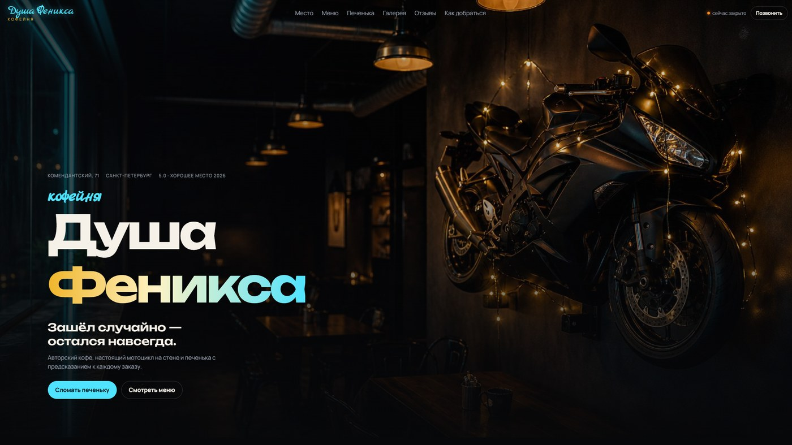

# 🔥 Кофейня «Душа Феникса»

<p align="center">
  
</p>

Авторский кофе, настоящий спортбайк на стене и печенька с предсказанием к каждому заказу. Не сеть и не «ещё одна точка на районе»: тёмные стены, неон, гирлянды и слоган «зашёл случайно — остался навсегда». Рейтинг 5,0, «Хорошее место 2026».

## 🏍️ Крутани ручку

На сайте можно крутить ручку газа: байк дрожит, ревёт холостой и орёт на оборотах — реальные wav-записи Kawasaki Ninja ZX-6R. Печеньку ломаешь кликом: звук хруста собран на Web Audio, из неё выпадает одно из двадцати предсказаний. Это не декоративный лендинг, а характер места, который можно потрогать.

Можно с собакой. Меню — сырный латте, матча-персик, авторка, а не «сиропы вслепую».

## 🛠️ На чём сделан

Одностраничник **HTML / CSS / JS**. Шрифты Unbounded, Manrope, Anonymous Pro и Marck Script. Звук мотора — файлы в `code/audio/`, хруст печеньки — Web Audio API. Отдельные фото для телефона (`img/m/`). Часы открытия считаются по Москве.

## ✨ Что реализовано

- Интерактивный газ: зажал ручку — крутятся обороты, байк трясётся, микс idle + scream.
- Печенька с предсказанием: клик, анимация разлома, случайная фраза, кнопка «ещё одну».
- Кастомный курсор на десктопе, прелоадер в виде тахометра «разогреваем мотор».
- Живой статус «открыто до 22:00 / сейчас закрыто» (будни с 8:00, выходные с 9:00).
- Меню на вкладках, лайтбокс галереи, появление блоков при скролле.
- Адаптивные `picture`: на телефоне грузятся более лёгкие кадры.

## 📁 Структура

```
├── full-website.png
├── readme-preview.jpg
├── pre-video.mp4
└── code/
    ├── index.html
    ├── css/
    ├── js/
    ├── img/
    └── audio/             # холостой и «ор» Ninja ZX-6R
```

## 🚀 Локальный запуск

```bash
cd code
python -m http.server 8080
```

Откройте `http://localhost:8080` в браузере.

---

## 👨‍💻 Разработчик

*   **Лаврешин Илья Александрович**

---

## 📧 Контакты

По всем вопросам и предложениям вы можете написать на почту:  
[](mailto:ilyalav2323@gmail.com)
