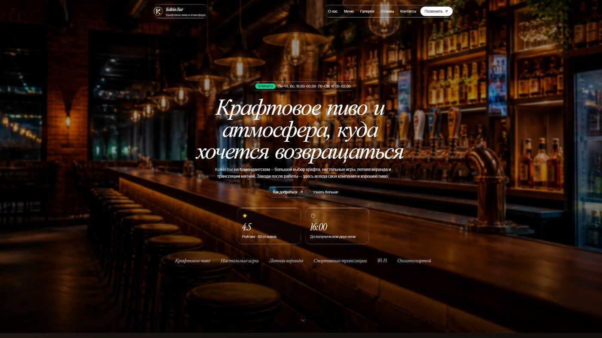

# 🍺 Kolkin Bar

<p align="center">
  
</p>

Крафтовый бар, а не пивной магазин с табуретками. Разлив и бутылки, настолки, летняя веранда, трансляции матчей. Тон спокойный: после работы, своя компания, без пафоса. Рейтинг 4,5.

## 🎲 Не только краны

Сайт держит четыре повода зайти сразу: пиво, игры, веранда и спорт. Это не «меню + карта», а вечерний сценарий — выбрать сорт, занять стол, включить матч. Ассортимент крафта с карточками (сорт, пивоварня, страна, градус), а не списком «у нас есть светлое».

## 🛠️ На чём сделан

Одностраничное приложение на **React**, собранное в бандл `assets/main.js`. Стили — `assets/styles.css`. Шрифты Barlow и Instrument Serif. Данные бара, отзывы и сорта пива живут в приложении, страница собирается на клиенте.

## ✨ Что реализовано

- Каталог крафта с описаниями, не просто названиями на кранах.
- Блоки про настолки, веранду и спортивные трансляции — четыре сценария визита, не один CTA.
- Живые отзывы гостей, галерея зала и полок, шапка, которая крепнет при скролле.
- Адаптивное меню: на телефоне бургер, на десктопе полная навигация.
- Тёплая «пивная» палитра и серьезная типографика — бар после работы, не ночной клуб.

## 📁 Структура

```
├── fullsize.png
├── readme-preview.jpg
└── code/
    ├── index.html
    ├── assets/
    │   ├── main.js        # собранный React
    │   └── styles.css
    └── images/
```

## 🚀 Локальный запуск

```bash
cd code
python -m http.server 8080
```

Откройте `http://localhost:8080` в браузере.

---

## 👨‍💻 Разработчик

*   **Лаврешин Илья Александрович**

---

## 📧 Контакты

По всем вопросам и предложениям вы можете написать на почту:  
[](mailto:ilyalav2323@gmail.com)
