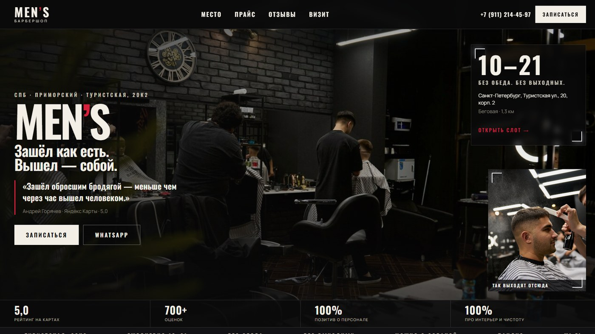

# ✂️ Барбершоп Мен’с

<p align="center">
  
</p>

Мужские и детские стрижки, борода, королевское бритьё. Не сеть и не конвейер: свой район, мастера из отзывов, слоты «отец и сын» и «друг + друг». Рейтинг 5,0, больше семисот оценок. Ежедневно 10:00–21:00, без обеда и без выходных.

## 💈 Зашёл как есть. Вышел — собой

Сайт держит тон зала: тёмный кирпич, линейный свет, красный апостроф в MEN’S. Не «премиум-барбершоп с вайбом лофта», а место, куда возвращаются, потому что мастер помнит «как обычно». Первая стрижка со скидкой, можно с собакой, первый этаж, пандус.

Запись через Яндекс. Онлайн-корзины нет — слот и кресло.

## 🛠️ На чём сделан

Одностраничник **HTML / CSS / JS**. Стили собраны Tailwind v4 из `css/source.css`. Шрифты Oswald и Manrope лежат локально в `fonts/`. Часы «открыто / закрыто» считаются по Москве. `prefers-reduced-motion` глушит курсор и тикеры. Без CMS и без React. Файлы — в корне папки.

## ✨ Что реализовано

- Живой статус смены: лампа пульсирует, пока салон открыт.
- Прайс «как на стекле»: вкладки стрижки / борода / комплексы / уход, фото меняется вместе с табом, стрелки на клавиатуре.
- Отзывы колодой: клик по голосу выводит цитату на весь кадр и имя мастера.
- Бегущая строка и лента работ, кастомный курсор на десктопе.
- Онлайн-запись в Яндекс, WhatsApp, карта, липкая пара «звонок / запись» на телефоне.
- Skip-link, фокус на бургер-меню, `motion-reduce` на ховерах фото.

## 📁 Структура

```
├── index.html
├── css/
│   ├── source.css
│   └── styles.css
├── js/
├── img/
├── fonts/
├── fullsize-website.png
├── readme-preview.jpg
├── pre-video.mp4
└── favicon.svg
```

## 🚀 Локальный запуск

```bash
python -m http.server 8080
```

Откройте `http://localhost:8080` в браузере.

---

## 👨‍💻 Разработчик

*   **Лаврешин Илья Александрович**

---

## 📧 Контакты

По всем вопросам и предложениям вы можете написать на почту:  
[](mailto:ilyalav2323@gmail.com)
