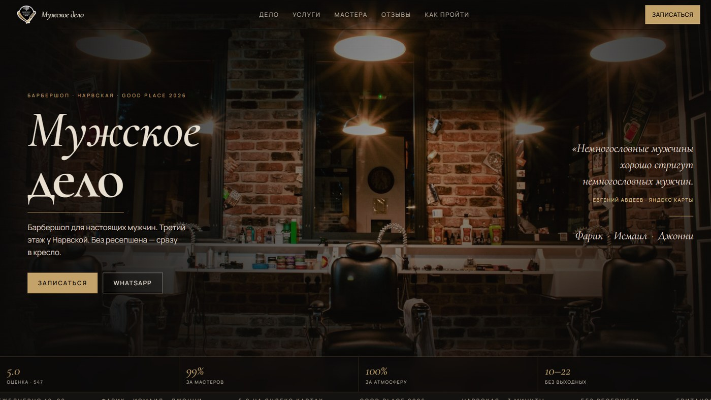

# 🪒 Барбершоп «Мужское дело»

<p align="center">
  
</p>

Небольшой барбершоп у Нарвской: стрижка, борода, королевское бритьё. Без ресепшена — сразу в кресло. Британский интерьер, картины на стенах, три мастера из отзывов. Рейтинг 5,0, «Good Place 2026». Ежедневно 10:00–22:00.

## 🪑 Сразу в кресло

Сайт не изображает сеть с улыбкой на стойке. Тон взял из отзыва: «немногословные мужчины хорошо стригут немногословных мужчин». Снаружи — советский ЦФТ, внутри — своё. Собака до 35 см, комплекс «папа + сын», запись в YClients.

Наверху страницы — латунная полоска-лезвие: она растёт вместе со скроллом.

## 🛠️ На чём сделан

Одностраничник **HTML / CSS / JS**. Стили — Tailwind v4. Шрифты Cormorant Garamond и Manrope локально в `fonts/`. JSON-LD `HairSalon`. Ловушка фокуса в мобильном меню, skip-link, `prefers-reduced-motion` на курсоре и ховерах. Без CMS и без React. Файлы — в корне папки.

## ✨ Что реализовано

- Прогресс-бар «лезвие»: линия в шапке показывает, как далеко долистали.
- Прайс на вкладках: голова, борода, комплексы. Сверху закреплён слот «папа + сын».
- Три карточки мастеров — Фарик, Исмаил, Джонни — с цитатами гостей и записью к каждому.
- Сетка отзывов на весь экран, карта, как пройти (метро, третий этаж, вход как в компьютерный клуб).
- Кастомный курсор на десктопе, шапка, которая крепнет после скролла.
- Липкая пара «позвонить / записаться» на телефоне.

## 📁 Структура

```
├── index.html
├── css/
├── js/
├── img/                   # в т.ч. логотип
├── fonts/
├── fullsize-website.png
├── readme-preview.jpg
└── pre-video.mp4
```

## 🚀 Локальный запуск

```bash
python -m http.server 8080
```

Откройте `http://localhost:8080` в браузере.

---

## 👨‍💻 Разработчик

*   **Лаврешин Илья Александрович**

---

## 📧 Контакты

По всем вопросам и предложениям вы можете написать на почту:  
[](mailto:ilyalav2323@gmail.com)
