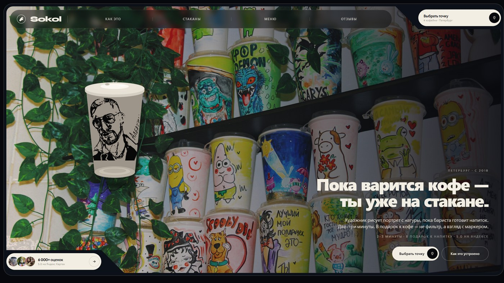

# 🦅 Sokol Coffee

<p align="center">
  
</p>

Петербургская сеть кофеен, где пока бариста варит напиток, художник рисует портрет гостя на стакане. Две–три минуты, в подарок к заказу, с натуры или по фото. Не фильтр и не принт из приложения — маркер и взгляд. Рейтинг 5,0, больше шести тысяч оценок по сети. Работают с 2018.

Продакшен: [sokolcoffee.ru](https://sokolcoffee.ru/)

## 🖊️ Ты уже на стакане

Сайт продаёт не «ещё один капучино», а ритуал: заказал → пока варится кофе → ушёл с портретом. На первом экране стакан живой: SVG-кружка, рука с маркером дорисовывает лицо. Четыре точки в городе, карта лояльности, галерея реальных стаканов гостей.

## 🛠️ На чём сделан

Одностраничное приложение на **React** (`js/app.js`) плюс собранные стили. Шрифты Outfit и Syne. JSON-LD `CafeOrCoffeeShop`, canonical на `sokolcoffee.ru`. Анимация стакана уважает `prefers-reduced-motion`.

В отличие от большинства лендингов коллекции, исходники лежат в корне папки, без обёртки `code/`.

## ✨ Что реализовано

- Анимированный стакан на первом экране: бумага, крышка, маркер, который «рисует» портрет.
- Ритуал в трёх шагах и меню напитков с зерном «Фонтанка бленд».
- Четыре точки с выбором локации в шапке и на странице.
- Галерея портретов гостей, отзывы, карта лояльности (кэшбек 15%).
- Шапка, которая меняется после скролла, мобильное меню, ссылки VK / Telegram / Instagram.

## 📁 Структура

```
├── index.html
├── css/
│   └── styles.css
├── js/
│   └── app.js             # собранный React
├── photos/
├── fullsize.png
├── readme-preview.jpg
├── pre-video.mp4
└── favicon.svg
```

## 🚀 Локальный запуск

```bash
python -m http.server 8080
```

Откройте `http://localhost:8080` в браузере.

---

## 👨‍💻 Разработчик

*   **Лаврешин Илья Александрович**

---

## 📧 Контакты

По всем вопросам и предложениям вы можете написать на почту:  
[](mailto:ilyalav2323@gmail.com)
