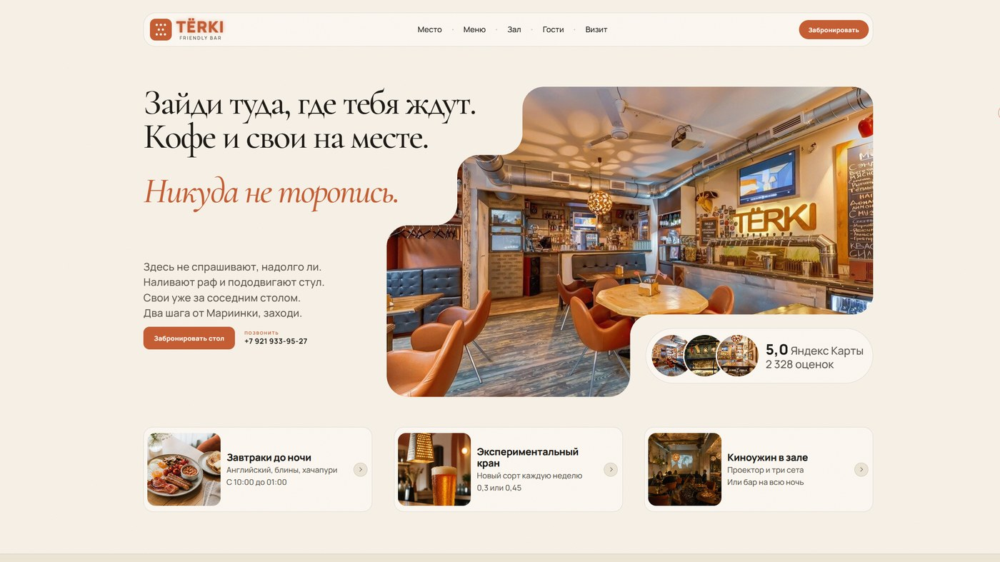

# 🧀 Бар «Тёрки»

<p align="center">
  
</p>

Небольшой бар для друзей: завтраки до закрытия, крафт на экспериментальном кране, настолки, пианино и киноужины. Название — про кухонные тёрки над барной полкой: лампочки внутри, зал в золотой крошке. Рейтинг 5,0, больше двух тысяч оценок. С 10:00 до 01:00 каждый день.

## 💡 Свет сквозь дырочки

Сайт не притворяется ночным клубом и не продаёт «гастробар в центре». Тон такой же, как зал: пододвинь стул, налей раф, никуда не торопись. Фирменная метафора — тёрка как светильник. На странице её можно потрогать: курсор гоняет свет по дырочкам, на телефоне блик гуляет сам.

Завтрак здесь берут и в полночь. Вечером — проектор, сет из трёх блюд, сидр.

## 🛠️ На чём сделан

Одностраничник **HTML / CSS / JS** (`js/app.js`). Шрифты Cormorant Garamond и Manrope. JSON-LD `BarOrPub`. Учитывает `prefers-reduced-motion`: без анимаций прелоадер и тёрка не шумят. Без CMS и без React.

## ✨ Что реализовано

- Интерактивная SVG-тёрка: дырочки в маске, свет следует за курсором.
- Четыре сцены дня (10:00 → 00:00), которые на десктопе крутятся со скроллом и ведут в нужный раздел меню.
- Большое меню на вкладках: завтраки, хачапури, пицца, паста, кран — с клавиатурной навигацией по табам.
- Отзывы колодой карт, горизонтальная лента зала, лайтбокс.
- Бронь через `<dialog>`: форма открывает письмо в почте, без бэкенда.
- Кастомный курсор и «магнитные» кнопки на десктопе, skip-link и ловушка фокуса в мобильном меню.

## 📁 Структура

```
├── fullsize.png
├── readme-preview.jpg
└── code/
    ├── index.html
    ├── css/
    ├── js/
    └── assets/
```

## 🚀 Локальный запуск

```bash
cd code
python -m http.server 8080
```

Откройте `http://localhost:8080` в браузере.

---

## 👨‍💻 Разработчик

*   **Лаврешин Илья Александрович**

---

## 📧 Контакты

По всем вопросам и предложениям вы можете написать на почту:  
[](mailto:ilyalav2323@gmail.com)
